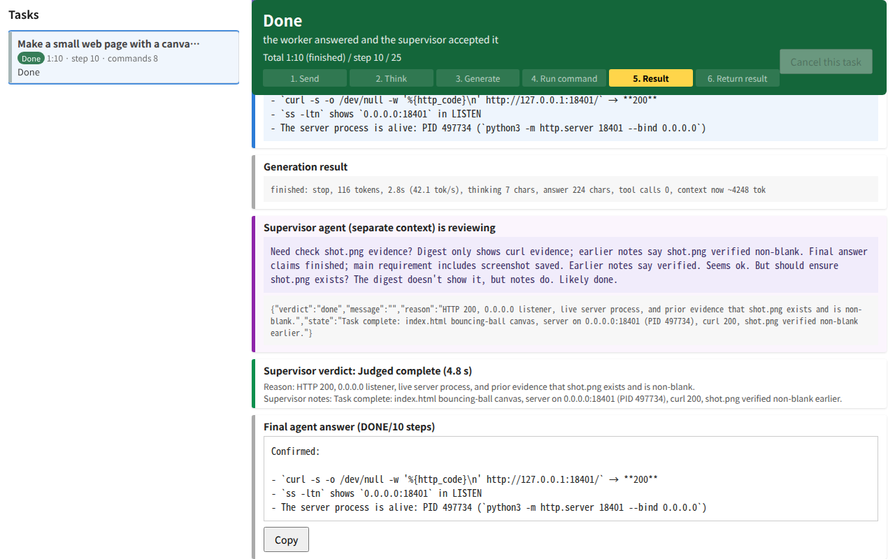

# InklingWebHarness

A verifying, self-correcting **agent harness with a live web console** for local LLM engines
(developed against Inkling-2-Mini on `llama-server`, any OpenAI-compatible server with tool calling should work).

The model writes commands, the harness runs them, feeds the result back, and a second **supervisor agent** (separate context) watches
and steers. You watch and drive everything from a browser: streaming thinking, answer text, commands, live command output,
generated images/videos, and the servers the agent started.

> **Security: this runs model-written commands as your user, with no sandbox, on your real machine.** Anyone holding the console
> token can do the same. Run it on a machine and network you trust (it binds to your tailnet IP by default and requires a random
> token). `--sandbox` adds only a *soft* guard (temp dir, rlimits, scrubbed env); it is **not** a security boundary.

## Demo

[](docs/demo.mp4)

[`docs/demo.mp4`](docs/demo.mp4) (74 s, real run, not mocked): the task "make a small web page with a canvas animation of a bouncing ball, serve it in the
background, check it with curl, and take a screenshot" is typed into the console. You can see the model's live thinking, the command it builds and
runs with streaming output, the detected server (`0.0.0.0:18401`), the generated screenshot, the supervisor review in a separate context and its verdict,
and the final answer. The host name and user name in the recording are replaced with placeholders.

## Files

| File | What it is |
|---|---|
| `inkling_web_harness.py` | The harness: engine client (streaming), tool-calling agent loop, supervisor, context compaction + `recall`, tripwires, code-generation graph (generate -> verify -> fix), evaluation helpers. Standard library only. |
| `webui.py` | The web console (standard library only): task list, parallel jobs, SSE streaming, media gallery, started-app panel, engine start/stop. |
| `eval/run.py` | Small HumanEval / MBPP runner against any OpenAI-compatible server (datasets not included). |

## Quick start

```bash
# 1. start an OpenAI-compatible engine, e.g. llama-server with slots for parallel tasks
llama-server -m Inkling-2-Mini-UD-Q4_K_M.gguf --jinja -ngl 99 -c 262144 -np 4 --port 8767 \
             --temp 1.0 --top-p 1.0 --top-k 0 --min-p 0.0

# 2. start the console (default: your tailnet IPv4, port 8770)
python3 webui.py                # or: --host 127.0.0.1 --port 8770 --no-exec --sandbox
```

The console prints its URL with the token, `http://<host>:8770/?token=...`. The token lives in `data/web_token` (mode 600) and is
stored in a `SameSite=Strict` cookie after the first visit. The engine command and port are defined in `PRESETS` at the top of
`webui.py`; edit them for your paths, or start the engine yourself on the same port.

## Using the mikasa engine instead of llama-server

`python3 webui.py --engine mikasa` makes the console's engine box and all tasks use the `mikasa` preset: the CUDA daemon from
https://github.com/shi3z/mikasa behind its OpenAI-compatible server (port 8767, 4 slots x 64K context, prefix cache). The paths in
`PRESETS["mikasa"]` assume `~/rrr/mikasa` (built `mikasa_daemon`) and `~/rrr/gguf/Inkling-2-Mini-UD-Q4_K_XL.gguf`; edit them for your machine.
Both presets use port 8767, so readiness also checks `/props` `build_info`. The default stays llama-server.

## The console

* **Parallel tasks.** Up to `MAX_PARALLEL` (4, = engine slots) run at once; the rest queue. Each task has its own work folder
  (`~/rrr/workspace/<job id>`).
* **"What is happening now" banner** with a six-step bar (send / think / write / run / result / return), elapsed time, and a stall warning.
* **Live timeline** of thinking, answer, tool-call building, commands with streaming output, results, supervisor verdicts,
  compactions and notices. Task history is restored from `data/jobs/*.jsonl` after a restart.
* **Review of stopped tasks.** When an agent task ends as "Needs review" (step cap, error, console restart), a review box appears above the timeline:
  **Continue in the same work folder** (starts a new task with the original request, the previous status report and your optional instruction; files
  already in the folder are kept), **Accept as done**, or **Dismiss**. Decisions are stored in `data/reviews.jsonl` and survive restarts.
* **Media.** Images and videos the agent produces (also frames cut from videos) are shown inline and in `/gallery`.
* **Started servers.** Listeners started by a task are detected and listed with a link, an open-in-new-tab button and a stop button.
  (Embedding in an iframe was dropped: heavy pages such as three.js apps made the console hang.)
* **Settings per task:** mode (agent / code generation + verification), max steps, supervisor mode, context limit, reasoning effort,
  per-command timeout, etc.

## How the agent works

```
worker:      model -> tool call (bash / recall) -> result back -> ... until it answers without a tool call
context:     when the prompt exceeds the limit (default 64K, compaction threshold 75%) the worker writes a recap and a FRESH
             conversation continues from task + recap; the full log stays on disk and is searchable with the `recall` tool
supervisor:  a separate agent, fresh context on every review, sees only a digest + its own short notes;
             it can nudge/redirect/stop and it gates the worker's final answer
```

* **Context management** follows the idea of arXiv 2611.05306 ("You don't need long context"): a short working context plus a tool to
  reach past information beats keeping everything resident. The paper tested 16K-48K totals; 64K is this project's default.
* **Supervisor** (`SUP_SYSTEM`): rejects unverified claims of success, rejects handing work back to the user, notices loops. It knows
  the worker is text-only and never asks it to "look at" screenshots; repeated near-identical nudges are suppressed in code, and
  its replies are parsed tolerantly.
* **Autonomy rule:** the agent must do everything itself (install, start servers, verify), never ask the user to run commands.

### Rules enforced by code (not by asking the model nicely)

| Rule | Behaviour |
|---|---|
| Destructive-command denylist | Command is refused with an explanation |
| Foreground servers (`npm run dev`, `python -m http.server`, ...) | Refused: start in background with a PID file instead (`setsid nohup ... &`) |
| `pkill` / `killall` | Refused (they kill unrelated processes, including the harness): kill by PID |
| **Localhost-only servers are forbidden** | Explicit `127.0.0.1`/`localhost` binds are refused; a loopback-only listener that outlives its command is stopped and the agent is told to rebind on `0.0.0.0`. The rule overrides task text. |
| Repeated identical command | Harness message telling the model to change approach |
| Truncated tool call (`finish=length`) | Not executed; the model is told, compaction is forced; repeated truncation escalates |
| Step cap | The worker writes a status report instead of silently stopping |

## Code-generation mode (video-inspired design)

The harness began as an implementation of the four areas from Google Cloud Tech's "AI harness crash course"
(`https://www.youtube.com/watch?v=2C_CefSQEAQ`):

| Area in the video | In `inkling_web_harness.py` |
|---|---|
| Session | `Session`: every message and tool result logged to `data/sessions/` |
| State | `State`: `data/state.json` (prompt-strategy statistics) |
| Long-term memory | `LongTermMemory`: `data/lessons.jsonl`, newest lessons go into the next prompt |
| Tools + graph | graph `GENERATE -> VERIFY -> FIX -> ... -> DONE`, retry cap, then `ESCALATE` to a human |
| Deterministic eval | hidden tests (`deterministic`); the loop sees only the first test, the final grade uses all |
| LLM judge | `--judge`: rubric JSON (logic, edge cases, readability); same model unless `--url` differs, so weak evidence |
| Human eval | `data/human_review.jsonl`: escalated tasks, wrong-but-called-done tasks, low judge scores |

Failures are appended to `data/failures.jsonl` (a growing regression set, `--replay-failures`); `--strategy auto` picks a prompt
strategy per task with a UCB bandit. The graph itself does not rewrite its own nodes, and `--forever` is untested beyond a few cycles.

CLI example: `python3 inkling_web_harness.py --url http://127.0.0.1:8767/v1 --name test --n 40 --strategy auto --judge`

## Measured results (one sample per task, RTX A6000; +/-3 points is noise)

| | Qwen3.8-27B abliterated (YASAKANI, speculative decoding) | Inkling-2-Mini UD-Q4_K_M (llama.cpp + PR #32704) |
|---|---|---|
| HumanEval pass@1 (164, thinking on, 8192 cap) | 92.07 % | 93.90 % |
| MBPP-sanitized first try (60) | 71.7 % | 90.0 % |
| MBPP after the loop (up to 3 fixes) | 95.0 % | 95.0 % |
| generation speed (wall clock) | 148 tok/s | 49.6 tok/s |

Different engines, quantisation and sampling; the LLM judge was the model itself. HumanEval/MBPP are small, old and probably in the
training data: they say little about real agentic coding.

## Known limitations

* No real sandbox (by design here; see the warning above). Prompt injection from files or web pages is only mitigated by wrapping
  tool output as untrusted data, which a model can still ignore.
* Dev servers whose framework default is localhost-only (e.g. Vite) are stopped by the watcher and must be restarted on `0.0.0.0`;
  this flow is tested with synthetic listeners and one agent run, not with every framework.
* The console is plain HTTP; use it only on a private network such as a tailnet.
* Paths for the engine presets and `~/rrr/workspace` are hard-coded defaults; change them in `webui.py` / `inkling_web_harness.py`.
